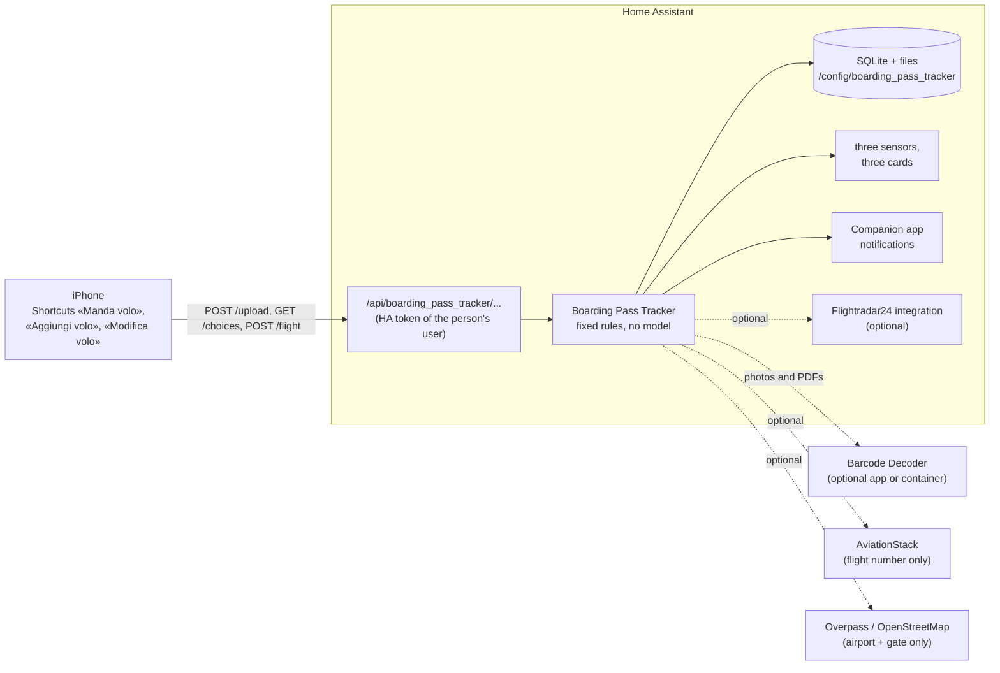

# boarding-pass-tracker

A flight companion for households that run [Home Assistant](https://www.home-assistant.io/), installed with
[HACS](https://hacs.xyz/). Send a boarding pass from your iPhone, as a Wallet pass (`.pkpass`) or as a photo,
screenshot or PDF of its barcode. It is read with fixed rules from the IATA barcode: **no AI model**. Or type the
flight in by hand, with its times, class, terminal and gate if you know them. The flight then lands in Home Assistant
as notifications, a gate reminder, three sensors and two dashboard cards.

The code and the documentation are in English, and so are the entity ids, attribute keys and the codes in their
values. **The user interface is Italian**: notifications, sensor states, the texts in the attributes, the replies
of the Shortcuts, the setup screens and the cards are written in Italian, for Italian-speaking households. Italian
texts are quoted between «…» in these documents, word for word.

## What it does

| You send | What happens |
|---|---|
| **Wallet boarding pass** (`.pkpass`) | Flight, date, route, seat, cabin and first name are read from the IATA BCBP barcode in the pass, plus the departure and arrival times, boarding time, terminal and gate when the airline put them in the pass. Needs nothing else. |
| **Photo, screenshot or PDF** of a boarding pass (JPEG, PNG, WebP, HEIC, PDF) | The optional [barcode decoder](https://github.com/7hemas7er/barcode-decoder) reads the barcode (Aztec, PDF417 or QR) and the pass is read the same way. An image without a boarding-pass barcode is archived, unread, and you are told. Without a decoder, photos and PDFs are refused with a message that says so. |
| **A flight typed by hand** (Shortcut «Aggiungi volo») | Flight code, day, route, the passengers with seat and class, and, each optional, the local departure and arrival times, terminal and gate. A flight from yesterday on is followed exactly like an uploaded pass; an older one only counts in the statistics. |
| **A change** (Shortcut «Modifica volo») | Pick any flight from a list: change its date, passengers, seats, classes, times, terminal or gate, or delete it. The sensors are updated before the Shortcut answers. |

And then, on its own:

- **Live flight status** from AviationStack (free plan, optional) within a fixed monthly call budget. You get a
  notification only when something changes: a new gate, a delay change of 15 minutes or more, a cancellation or a
  diversion. AviationStack's real data wins over times typed by hand.
- **Gate reminder** (the notification «avviati al gate») for the person who uploaded the pass. It is timed by cabin
  class and by the walk from the phone's position to the gate, using OpenStreetMap.
- **Flightradar24 tracking** (optional): the next flight is added to the Flightradar24 integration's tracked list,
  for a live position on the card and on a map.
- **Flight statistics**: hours in the air, km, delays, punctuality, countries, airports, airlines, routes, records
  and a year-by-year table, for the whole household or for each passenger.
- **Three sensors**: the next flight, the upcoming flights and the statistics.
- **Two custom cards**, loaded by the integration itself: an animated card for the next flight and a statistics
  card. A ready dashboard (`dashboards/flights.json`) uses them.
- **Repairs and diagnostics**: Home Assistant tells you when a sensor id is taken, the decoder is down or a
  phone's notify service is gone, and the downloadable diagnostics hold counts only.

## How it works



1. A Shortcut sends the file to `POST /api/boarding_pass_tracker/upload` on your Home Assistant, with the long-lived
   token of that person's Home Assistant user. The token is the identity: it decides who uploaded the pass.
2. The integration stores the file under `/config/boarding_pass_tracker` and answers at once. A worker then decides
   the type from the file content, never from its name: a Wallet pass is opened as a ZIP, a photo or PDF goes to the
   decoder, which returns the barcode texts and keeps nothing.
3. **Fixed rules only.** The IATA BCBP fields have fixed positions and are checked one by one; a barcode that breaks
   a rule is not a boarding pass. Nothing is guessed, and there is no model to call.
4. The uploader gets a notification. A clock then checks the flight status, sends the gate reminder, keeps
   Flightradar24 up to date and refreshes the sensors.
5. «Aggiungi volo» and «Modifica volo» send JSON to `POST /api/boarding_pass_tracker/flight` (and read the pick list
   from `GET /api/boarding_pass_tracker/choices`). Every field is checked, the change is written in one transaction,
   the sensors are refreshed and only then the Shortcut gets its Italian `message`.

Details: [docs/ARCHITECTURE.md](docs/ARCHITECTURE.md).

## Privacy model

- **No model, no cloud OCR.** Boarding passes are read inside your Home Assistant, or by a decoder you run yourself.
- **Only these destinations are ever contacted**, each optional:
  - **AviationStack** receives the flight number (for example `FR1234`) and your API key. Never names, seats or
    booking codes.
  - **Flightradar24**, through its own Home Assistant integration, receives the flight number.
  - **Overpass (OpenStreetMap)** receives the departure airport's coordinates and the gate code. Never your position:
    the walk to the gate is computed locally.
  - **The Home Assistant app's push relay (Apple or Google)** carries the text of a notification, when your phone
    has no local push channel.
  - **The decoder** you configure receives your photos and PDFs, and nothing else.
- **The PNR (booking code) and the surname are never sent anywhere.** The PNR is not stored in the database: it stays
  only inside the uploaded file. Full passenger names stay in the local database; Home Assistant shows first names
  and seats (and a name typed by hand as it was typed).
- Photos and passes are stored under `/config/boarding_pass_tracker`, which Home Assistant backups include.

More in [docs/PRIVACY.md](docs/PRIVACY.md).

## Requirements

- **Home Assistant 2026.10.0 or later**, with [HACS](https://hacs.xyz/).
- The **Companion app** on each phone (notifications, and the position that times the gate reminder) and a
  **person** entity per user.
- A way to reach Home Assistant from outside your home, if you want to send passes from an airport: Nabu Casa, a
  reverse proxy or a VPN such as Tailscale. Any of them works; the integration does not care which.
- iPhones with the **Shortcuts** app. The API is plain HTTP, so other clients work too, but the instructions cover iOS.
- Optional: the **Barcode Decoder** (a Home Assistant OS app, or a Docker container) for photos and PDFs; a free
  **AviationStack** API key (flight status); the **Flightradar24** integration (live position).

## Quick start

Follow [docs/INSTALL.md](docs/INSTALL.md). In short:

1. HACS › ⋮ › **Custom repositories**: add `https://github.com/7hemas7er/boarding-pass-tracker` as an
   **Integration**, download it and restart Home Assistant.
2. Optional, for photos and PDFs: install the Barcode Decoder app from
   `https://github.com/7hemas7er/barcode-decoder`, or run its Docker image.
3. **Settings › Devices & services › Add integration › Boarding Pass Tracker**: add the people, the optional keys and
   the decoder address.
4. On each phone, create the three Shortcuts and paste your own token into them.

## Documentation

| Document | Contents |
|---|---|
| [docs/INSTALL.md](docs/INSTALL.md) | HACS, the decoder, the setup flow, tokens, the three Shortcuts, verification, uninstall |
| [docs/CONFIGURATION.md](docs/CONFIGURATION.md) | Every flow step, option and person field, the errors they show |
| [docs/HOME_ASSISTANT.md](docs/HOME_ASSISTANT.md) | Entities and attributes, notifications, the cards, services, repairs, diagnostics, backups |
| [docs/FLIGHTS.md](docs/FLIGHTS.md) | Boarding passes, flights typed by hand, times and airport zones, AviationStack, gate reminder, statistics |
| [docs/ARCHITECTURE.md](docs/ARCHITECTURE.md) | Modules, threads, storage, the HTTP API, the decoder API |
| [docs/PRIVACY.md](docs/PRIVACY.md) | What is stored, what leaves Home Assistant, tokens, backups, removal |
| [docs/TRANSLATION_MAP.md](docs/TRANSLATION_MAP.md) | Developer note: Italian and English names, and where Italian texts live |
| [dashboards/README.md](dashboards/README.md) | The three cards, their options, and the dashboard to import |
| [THIRD_PARTY.md](THIRD_PARTY.md) | Data and components the repository ships, with their licences |

## Project layout

```
boarding-pass-tracker/
├── custom_components/boarding_pass_tracker/   the integration (what HACS installs)
│   ├── core/                  the rules: engine, flights, manual entry, statistics, barcodes client (no Home Assistant import)
│   ├── frontend/              the loader and the three cards
│   ├── translations/          it.json and en.json: every screen, entity name and repair
│   └── *.py                   the Home Assistant shell: setup, views, sensors, flows, repairs, backup hooks
├── dashboards/                the flights dashboard to import (the cards are in frontend/)
├── docs/                      documentation
├── tests/                     core and integration tests
├── tools/                     the airport time zone builder and a repository check
├── hacs.json
└── THIRD_PARTY.md
```

The core tests (Python 3.12 or later, with `tests/core/requirements.txt`) use fakes and touch nothing outside a
temporary directory:

```bash
python3 -I -B tests/core/run.py                       # once, in the Europe/Rome time zone
python3 -I -B tests/core/run.py --final               # also three other time zones and four fake instants
```

The integration tests (Python 3.14 or later) need Home Assistant's test requirements; the steps are at the top of
`tests/integration/requirements.txt`, and the command is `python -m pytest tests/integration`.

## Status and limitations

boarding-pass-tracker 1.0.0 is the Home Assistant integration. It is built for one household and is not a polished
product.

- **iOS-centric.** The Shortcuts and the Wallet pass flow are for iPhone. Android's Companion app receives the
  notifications, but the sending side is not documented. Try each Shortcut once on your iPhone
  ([verification](docs/INSTALL.md#verify)), because the Shortcuts actions that read dictionaries and dates differ
  between iOS versions.
- **One shared archive.** All configured people see every flight and receive every flight-change notification, and
  each of them can edit or delete every flight, with no undo.
- **A token opens the whole API of its user.** Each Shortcut holds a long-lived token. A dedicated non-admin Home
  Assistant user per person is safer; see [docs/PRIVACY.md](docs/PRIVACY.md#tokens).
- **AviationStack free plan**: 100 calls a month, and only yesterday's and today's flights. The integration uses at
  most 95 calls (configurable). Past flights that you upload late or add by hand count in the statistics, but
  without AviationStack's times.
- **Typed times are only as good as you typed them.** A mistyped flight number or day shows only when AviationStack
  is first asked. The reply of «Aggiungi volo» repeats what was stored: check it, and fix a mistake by deleting the
  flight and adding it again.
- **Photos and PDFs need the decoder**, and HEIC needs the decoder image (a source checkout has no HEIF library).
- **The decoder has no authentication by design.** Keep it on Home Assistant's internal network or on 127.0.0.1.
- Limits that protect Home Assistant and the phones: 25 MiB per upload, photos over 50 megapixels rejected before
  decoding, PDFs read up to 3 pages, at most 4 legs per pass; 16 KiB per request of «Aggiungi volo» and «Modifica
  volo», at most 9 passengers on a flight by hand, at most 200 flights in the list.

## License

[MIT](LICENSE) © boarding-pass-tracker contributors.

## Credits

- Airport coordinates and countries in `custom_components/boarding_pass_tracker/core/airports.json` come from
  [OurAirports](https://ourairports.com/data/) (public domain).
- Airport time zones are built from [airportsdata](https://github.com/mborsetti/airportsdata) (MIT) and the IANA
  time zone database through [tzdata](https://github.com/python/tzdata); the sources, versions and digests are in
  [THIRD_PARTY.md](THIRD_PARTY.md).
- The icons in the cards (`mdi:airplane`, plus `mdi:alert-circle-outline` and `mdi:cog-outline` in the
  statistics card and `mdi:plus` and `mdi:pencil` in the manage card) are from [Material Design Icons](https://pictogrammers.com/library/mdi/) by Pictogrammers
  (Apache License 2.0).
- Boarding passes are read according to the IATA Bar Coded Boarding Pass (BCBP) standard, Resolution 792.
- Barcodes are decoded by the separate [barcode-decoder](https://github.com/7hemas7er/barcode-decoder) with
  [zxing-cpp](https://github.com/zxing-cpp/zxing-cpp) (Apache License 2.0).
- This project is not affiliated with AviationStack, Flightradar24, OpenStreetMap, Tailscale, Nabu Casa or Home
  Assistant.
